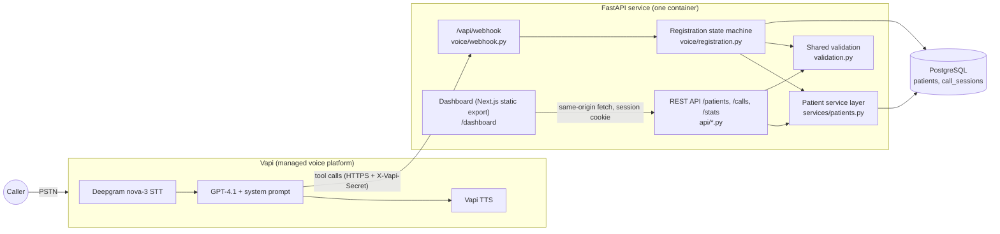

# Voice AI Patient Registration

Call a U.S. phone number and register as a new patient by talking to an AI intake assistant. The agent collects the standard demographic dataset conversationally, validates each answer, reads everything back, and saves to PostgreSQL only after you confirm. The records are available through an authenticated REST API and an admin dashboard.

## Live demo

| | |
|---|---|
| Phone number | **+1 (948) 222-9061** |
| API base URL | `https://voice-ai-patient-registration-9cd2.onrender.com` |
| API docs (OpenAPI) | `https://voice-ai-patient-registration-9cd2.onrender.com/docs` |
| Dashboard | `https://voice-ai-patient-registration-9cd2.onrender.com/dashboard/` |
| Access key | Sent with the submission, not committed. Use it as `Authorization: Bearer <key>` or on the dashboard login. |

Try it:

1. Call the number and register (use made-up details). Try correcting a field, giving a future birth date, or saying "start over".
2. `curl -H "Authorization: Bearer $KEY" "https://voice-ai-patient-registration-9cd2.onrender.com/patients?last_name=<your last name>"`
3. Call again and give the same phone number. After you confirm your date of birth, the agent offers to update your existing record instead of creating a duplicate.

## Architecture



The layers are separated as follows:

| Layer | Where | Responsibility |
|---|---|---|
| Telephony, STT, TTS, LLM hosting | Vapi | Phone number, speech, barge-in, silence handling. Configured in code (`app/voice/assistant.py`), not by hand. |
| Conversation design | `app/voice/prompt.py`, `app/voice/tools.py` | System prompt and tool schemas. |
| Conversation state and rules | `app/voice/registration.py` | Per-call draft record, validation, confirm-before-save, duplicate detection, idempotent save. |
| Validation | `app/validation.py` | One rule set shared by the API schemas and the voice tools. |
| Business logic and persistence | `app/services/patients.py`, `app/models.py` | The only code that touches the `patients` table. |
| HTTP | `app/api/*.py`, `app/main.py` | REST endpoints, envelope, error mapping, auth. |
| UI | `dashboard/` | Admin console. Built to static files and served by FastAPI. |

### Why the server, not the LLM, owns the conversation state

The LLM handles natural language: varied phrasing, out-of-order answers, small talk, and Spanish. Everything that must be correct lives server-side and is enforced in code:

- Every captured value goes through `update_patient_info`, which validates it with the same rules as the API and stores it in a per-call draft (`call_sessions.draft`). Invalid values are never stored. The tool returns a specific reason, such as "date of birth cannot be in the future", and the agent re-asks for that field only.
- `review_registration` returns the exact draft formatted for read-back and records a hash of it.
- `submit_registration` refuses to write unless the caller confirmed and the draft is unchanged since the last read-back. If the caller changes anything after the read-back, it has to be read back again.
- The save is idempotent per call (`Idempotency-Key: vapi-call:<id>`), so a retried tool call cannot create a duplicate patient.
- If the database write fails, the tool returns `success:false`, and the prompt forbids claiming success. The caller hears an apology and can retry.

## Tech stack and why

| Choice | Why |
|---|---|
| Vapi | Phone number, low-latency STT/TTS, barge-in, and tool calling in one managed service. The brief recommends it, and it leaves the time for prompt design, state handling, and the backend. |
| GPT-4.1 (via Vapi) | Reliable at function calling and at following strict format rules in a long system prompt. Temperature 0.3 keeps tool arguments consistent. |
| Deepgram nova-3, `multi` language | Good accuracy on numbers and names, and handles English and Spanish in one stream (bonus requirement). |
| FastAPI + Pydantic v2 | Typed request validation and automatic OpenAPI docs. |
| PostgreSQL + SQLAlchemy 2 + Alembic | Real constraints (CHECK, enum, partial indexes), JSONB for the call draft, row locks for concurrent tool calls, and migrations instead of ad-hoc DDL. |
| Next.js static export + Tailwind | A real dashboard without a second server. The same origin means an HttpOnly session cookie, no CORS, and no API key in the browser. |
| One Docker image on Render (free tier) | One deployable unit plus managed Postgres, with no card required. Migrations run on boot, and a `/ready` health check gates traffic. Railway was the first choice, but its free trial had expired. |

## Voice conversation flow

```
greeting (AI disclosure, asks for name)
  -> collect required fields in any order (each answer -> update_patient_info -> validated)
       |- invalid value       -> specific re-prompt for that field only
       |- correction          -> update_patient_info again (overwrites)
       |- phone already on file -> ask DOB -> verify_existing_patient -> "we already have a record
       |                           for <First Last>, update instead?" -> use_existing_record
       '- "start over"        -> confirm -> start_over
  -> offer optional fields in one question (insurance, emergency contact, language, email);
     enforced: the first review_registration is rejected until the offer has been prompted
  -> review_registration -> read back in chunks, names spelled out
  -> caller confirms -> submit_registration -> "You're all set, <First Name>." -> goodbye -> endCall
                     '- caller corrects -> update -> review again
```

These edge cases are handled:

| Situation | Behavior |
|---|---|
| Invalid DOB, phone, ZIP, or state | Server rejects the value with a reason. The agent explains and re-asks for that field only. |
| Caller gives several fields at once, or out of order | Everything is saved in one tool call. `missing_required` drives what to ask next. |
| Interruptions | Vapi `stopSpeakingPlan`: the agent stops after about 2 words of caller speech. The prompt says not to restart the interrupted sentence. |
| Silence | After 12s: "Are you still there?" (up to twice). After 40s: polite goodbye and hang-up. |
| Caller hangs up or the line drops | No partial patient record is written. The end-of-call report marks the session `abandoned` and stores the transcript and partial draft for staff follow-up. |
| Database write fails | `success:false`. The agent apologizes, says nothing was saved, and offers one retry. The call log records `outcome=failed` and the error. |
| Duplicate or retried tool calls | Session row lock (`SELECT ... FOR UPDATE`) plus an idempotency key. A second submit returns `already_saved`. |
| Returning caller | Phone match triggers DOB verification. No name is revealed until phone and DOB both match. Same phone with a different DOB is treated as a family member, and a new record is created. |
| Correction after saving | The next submit updates the record just created. It does not create a second one. |
| Spanish speaker | The agent switches to Spanish and sets preferred language to Spanish. |
| Medical emergency or out-of-scope request | Directs to 911 or the clinic line. Never asks for SSN or card numbers. |

The full prompt, with design notes, is in [`backend/app/voice/prompt.py`](backend/app/voice/prompt.py). Tool schemas are in [`backend/app/voice/tools.py`](backend/app/voice/tools.py). To print the exact assistant JSON sent to Vapi, run `python -m scripts.setup_vapi --dry-run`.

## Database schema

`patients` (migration [`0001`](backend/alembic/versions/0001_initial_schema.py)):

| Column | Type | Constraint |
|---|---|---|
| patient_id | UUID PK | `gen_random_uuid()` |
| first_name, last_name | varchar(50) | 1–50 chars. Letters, hyphens, apostrophes (validated in the app layer). |
| date_of_birth | date | ≥ 1900-01-01. Not in the future (checked against clinic-local "today" in the app layer). |
| sex | enum `sex_enum` | Male / Female / Other / Decline to Answer |
| phone_number, emergency_contact_phone | varchar(10) | CHECK NANP format `^[2-9]\d{2}[2-9]\d{6}$` |
| email | varchar(254) | RFC check in the app layer |
| address_line_1 / address_line_2 | varchar(100) | line 1 required |
| city | varchar(100) | 1–100 chars |
| state | varchar(2) | CHECK in the 50 states + DC, PR, GU, VI, AS, MP |
| zip_code | varchar(10) | CHECK `^\d{5}(-\d{4})?$` |
| insurance_provider, insurance_member_id | varchar | member ID CHECK `^[A-Z0-9]{1,30}$` |
| preferred_language | varchar(50) | default `English` |
| emergency_contact_name | varchar(100) | |
| idempotency_key | varchar(100) UNIQUE | Makes create safe to retry |
| created_at, updated_at, deleted_at | timestamptz (UTC) | soft delete via `deleted_at` |

Indexes: a partial index on `phone_number WHERE deleted_at IS NULL` (returning-caller lookup), `lower(last_name)`, `date_of_birth`, and `created_at`.

`call_sessions` holds one row per call: the in-progress draft (JSONB), state, mode (create/update), outcome, the linked `patient_id`, timing, ended reason, transcript, and summary. The dashboard's call history reads from this table.

## REST API

All patient and call endpoints require `Authorization: Bearer <API_KEY>` (or `X-API-Key`). Responses always use this envelope:

```json
{ "data": { ... }, "error": null }
{ "data": null, "error": { "code": "VALIDATION_ERROR", "message": "One or more fields are invalid.",
                           "details": [{ "field": "zip_code", "message": "must be a 5-digit ZIP code or ZIP+4 (12345-6789)" }] } }
```

| Method | Path | Notes |
|---|---|---|
| GET | `/patients` | Filters: `last_name` (case-insensitive), `date_of_birth` (MM/DD/YYYY or ISO), `phone_number` (any format). Also `q`, `sort`, `order`, `limit` (≤100), and `offset`. Pagination is returned in `meta`. |
| GET | `/patients/{id}` | 404 if missing or soft-deleted. 400 if the id is not a UUID. |
| POST | `/patients` | 201 with the created record. Optional `Idempotency-Key` header: a replay returns 200 with the same record. |
| PUT | `/patients/{id}` | Partial update. `null` clears optional fields. Required fields cannot be set to null. |
| DELETE | `/patients/{id}` | Soft delete: sets `deleted_at` and hides the record from reads. |
| GET | `/patients/{id}/calls` | Calls linked to the patient |
| GET | `/calls`, `/calls/{id}` | Call log (detail includes the transcript) |
| GET | `/stats` | Dashboard aggregates, computed from the DB |
| GET | `/health`, `/ready` | Liveness, and readiness (DB check). No auth. |
| POST | `/auth/login`, `/auth/logout` | Dashboard session cookie (HttpOnly, SameSite=Strict) |
| POST | `/vapi/webhook` | Vapi only. Requires the `X-Vapi-Secret` header. |

Status codes: 200, 201, 400 (malformed JSON, bad query or id), 401, 404, 422 (field validation), 500 (generic message, details only in logs), 503 (`/ready` when the DB is down).

## Local setup

Prerequisites: Python 3.12+, Node 20+, PostgreSQL 14+.

```bash
createdb patient_registration && createdb patient_registration_test

cd backend
python3 -m venv .venv && source .venv/bin/activate
pip install -r requirements-dev.txt
cp ../.env.example .env            # edit values
alembic upgrade head
python -m scripts.seed             # optional demo data
uvicorn app.main:app --reload      # http://localhost:8000/docs

# dashboard (separate terminal); set CORS_ORIGINS=http://localhost:3000 in backend/.env
cd dashboard && npm install
NEXT_PUBLIC_API_BASE=http://localhost:8000 npm run dev   # http://localhost:3000/dashboard
```

To make phone calls against a local backend, expose it with `ngrok http 8000`, then run `setup_vapi.py` with `PUBLIC_BASE_URL` set to the ngrok URL.

Build and run everything as in production:

```bash
docker build -t patient-registration .
docker run -p 8000:8000 --env-file backend/.env -e DATABASE_URL=postgresql://host.docker.internal/patient_registration patient-registration
```

## Environment variables

| Variable | Required | Purpose |
|---|---|---|
| `DATABASE_URL` | yes | PostgreSQL URL (`postgres://` and `postgresql://` are accepted) |
| `API_KEY` | yes | Admin bearer token for the API, and the dashboard access key |
| `SECRET_KEY` | yes | Signs dashboard session cookies |
| `VAPI_WEBHOOK_SECRET` | yes | Shared secret Vapi sends as `X-Vapi-Secret` |
| `ENVIRONMENT` | prod | `production` sets the Secure flag on cookies |
| `CORS_ORIGINS` | no | Extra allowed origins (only for the dashboard dev server) |
| `LOG_PII` | no | `false` (default) masks patient fields in logs |
| `CLINIC_TIMEZONE` | no | Defines "today" for DOB validation. Default `America/New_York`. |
| `SEED_DEMO_DATA` | no | `true` inserts 2 synthetic patients on boot (idempotent) |
| `VAPI_API_KEY`, `PUBLIC_BASE_URL` | setup script only | Used by `scripts/setup_vapi.py`. Not needed at runtime. |

## Deployment (Render, free tier)

1. In Render, choose **New → Blueprint** and select this repo. [`render.yaml`](render.yaml) creates a free PostgreSQL database and a free Docker web service. `DATABASE_URL` is wired automatically and `SECRET_KEY` is generated.
2. Enter `API_KEY` and `VAPI_WEBHOOK_SECRET` when prompted. Generate them with `openssl rand -hex 32`.
3. On every deploy the container runs `alembic upgrade head`, then the idempotent seed, then uvicorn. Render only routes traffic once `/ready` passes.
4. Point the voice agent and phone number at the deployment:

   ```bash
   cd backend
   VAPI_API_KEY=... PUBLIC_BASE_URL=https://<service>.onrender.com VAPI_WEBHOOK_SECRET=<same as server> \
     python -m scripts.setup_vapi --provision-number --area-code 948
   ```

   Re-running the script updates the assistant in place (prompt, tools, webhook URL). It provisions a number only if none is attached. Free Vapi numbers are limited to the area codes Vapi currently has available.
5. Set the repository variable `APP_URL` to the service URL. The [keep-warm workflow](.github/workflows/keep-warm.yml) then pings `/ready` every 10 minutes, so the free instance doesn't sleep and the first tool call of a phone call isn't slowed by a cold start.

Pushes to `main` redeploy automatically. [CI](.github/workflows/ci.yml) runs the backend tests against PostgreSQL 16 and lints and builds the dashboard.

## Testing

```bash
cd backend && pytest        # uses the patient_registration_test database (TEST_DATABASE_URL to override)
```

The tests run against real PostgreSQL migrated with Alembic, so the database constraints are exercised too. They cover:

- **Validation units:** phone normalization, DOB rules (real date, not in the future), state names and codes, sex synonyms, and name character rules.
- **API:** create, get, list, the three filters plus search, sort, and pagination, partial update, clearing optional fields, and soft delete (the row still exists). Also 400/401/404/422 envelopes, idempotent create, auth (bearer, X-API-Key, and the cookie login/logout flow), stats, and a check that error responses don't echo rejected input.
- **Voice webhook,** driven exactly as Vapi calls it:
  - Webhook secret enforcement; dashboard credentials are rejected on the webhook.
  - A full happy-path registration, and invalid values re-prompted with specific reasons.
  - Corrections, including the D-A-V-I-E-S to D-A-V-I-S example.
  - No save without read-back and confirmation; edits after review force a re-review.
  - Idempotent double submit, start over, and clearing optional fields.
  - Arguments sent as a JSON string, and unknown tools.
  - A simulated DB failure: the caller is told nothing was saved, and a retry succeeds.
  - Dropped calls, the returning-caller flow (no identity leak before DOB matches), shared family phones, declining the update, and corrections after save.

Latest results: **98 passed** locally (PostgreSQL 18) and in GitHub Actions CI (PostgreSQL 16). The dashboard passes `npm run lint` and `npm run build` cleanly.

These were also verified against the live deployment:
- `/ready` and the seed data;
- 401 without credentials;
- create → 422 with field reasons → partial update → phone filter → soft delete (then 404);
- webhook secret enforcement and the dashboard cookie login.

Six live phone calls to the production number (2026-10-10) completed five real registrations and exercised these flows:
- A future DOB ("2029") was rejected and re-asked.
- A phone number starting with 0 was rejected with the specific reason.
- A 4-digit ZIP was re-asked.
- A mid-call correction ("Actually, my address is 578 Main Street") replaced the earlier address.
- After the read-back and "Yeah", the record was saved and the agent said "You're all set, Sarah."
- A post-registration medical question was redirected to the clinic line and 911.
- An earlier call where the caller declined to give an address ended with no patient record and a stored transcript.

These calls also surfaced issues that are now fixed:
- The optional-fields offer was skipped, including once when the model claimed via a flag that it had asked. It is now enforced by the server: the first `review_registration` of a new registration is always rejected with "ask about the optional fields now", and the server records that it did so. No flag set by the LLM is trusted.
- In one call the model changed a spoken birth year (2026 → 2020). It is now told never to alter values; the read-back plus the caller's confirmation is the backstop.
- The agent once skipped "You're all set". The save result now includes the exact sentence to say next (`say_next`).
- The agent asked for both name spellings in one turn, and the answers ran together. It now asks for one spelling at a time.
- The prompt rule "always ask the caller to spell their last name" was not reliably followed. When a name is saved, `update_patient_info` now returns a reminder to ask for its spelling at that moment.
- An apartment number was wrongly counted as "caller already gave optional details", which skipped the offer. Only insurance, emergency contact and email now count.
- A last name was misheard by speech recognition. The agent now always asks callers to spell their last name.
- A misheard city ("Miles Angeles") was accepted. The agent is now told to question implausible place names.

## Security and privacy

- No secrets in the repo. All credentials come from environment variables, and `.env.example` has placeholders only.
- Patient and call endpoints require the admin key or a signed HttpOnly session cookie. The browser never holds the API key after login.
- The Vapi webhook is authenticated separately with `X-Vapi-Secret` (constant-time compare). Dashboard credentials do not work on the webhook, and webhook auth cannot lock out the dashboard.
- Input is validated server-side twice: Pydantic with the shared rules, then database CHECK constraints. Unknown fields are rejected. SQL goes through the ORM with bound parameters.
- Error responses never echo submitted values. 500s return a generic message.
- Logs are structured JSON on stdout with PII masked by default (`LOG_PII=false`). Query strings are not logged because filters can contain phone numbers or DOBs.
- Existing-patient identity is only revealed after phone and DOB both match. Verification is limited to 2 attempts per call.
- Transcripts are only available through authenticated endpoints. Call recording is not enabled.
- All demo data is synthetic, using 555-01xx fictional phone numbers.

## Known limitations and trade-offs

- **Free-tier hosting.** Render's free Postgres expires 30 days after creation (this one on 2026-11-09). Moving to a free Neon database only requires changing `DATABASE_URL`. The free web instance can sleep, which the keep-warm workflow mitigates. GitHub cron can be delayed, so the first request after a long idle period may take about 30–60s.
- **Not HIPAA-compliant.** Vapi and OpenAI process the audio and text without a BAA in this setup, as the brief allows.
- **Single shared admin key** instead of per-user accounts and roles. This is fine for a reviewer demo, but the next step for production is SSO with an audit log.
- **Names allow internal spaces** ("De La Cruz") in addition to the letters, hyphens, and apostrophes the spec lists. This is a deliberate relaxation for real-world surnames.
- **DOB is returned as ISO `YYYY-MM-DD`** in JSON. The API accepts MM/DD/YYYY or ISO, and the agent reads dates back in spoken U.S. format.
- **Returning-caller detection uses the phone number the caller provides**, not caller ID. That is deliberate, because caller ID can be spoofed and family phones are shared.
- **Abandoned calls keep their partial draft** on the call session (visible to staff) but never create a patient.
- **The "today" for DOB validation is clinic-local** (`CLINIC_TIMEZONE`), not per caller.
- **Speech recognition of spelled names and emails** is the weakest link of any voice agent. The prompt asks callers to spell ambiguous names and reads names back letter by letter.

## Next steps

- Per-user dashboard auth (OIDC) with an audit trail of who viewed or edited which record.
- Appointment scheduling tool (bonus) on top of the same session and state machine.
- Encrypt sensitive columns at rest and add a retention policy for transcripts.
- Post-call SMS confirmation via Twilio, and a callback queue for abandoned registrations.
- Automated voice regression tests: scripted calls through Vapi's test suites, run against the prompt in CI.
